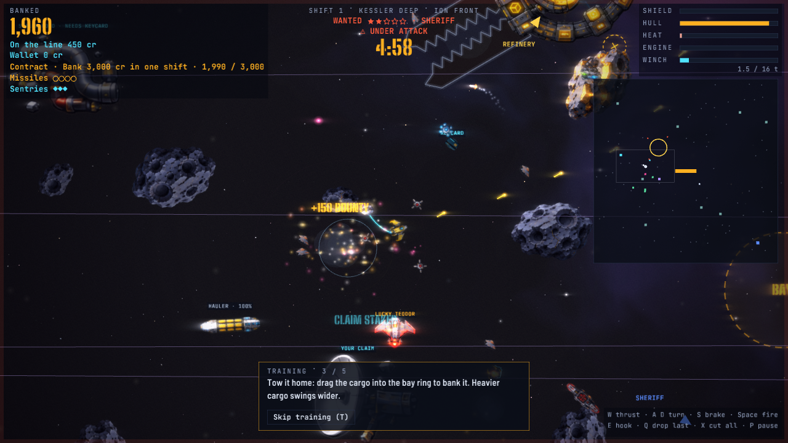

# Claim Jumpers

**A GitHub Game Off 2026 entry. Theme: SHIFT.**

You're a salvage tug pilot with a loan to pay off. Every round is a
five-minute **shift** in the asteroid belt: break rocks, cut open wrecks,
hook anything valuable onto your tow cable and drag it into the carrier bay
before rival crews, debt collectors or the law take it from you. After each
shift the bank takes its installment, and the belt itself shifts: new
conditions, new contracts, a bigger installment.

- **How to play:** read the [gameplay guide](native/docs/guide/GAMEPLAY.md),
  which has screenshots.
- **Platform:** Windows 10 and 11 (64-bit).
- **Modes:** single player, local co-op, and online co-op with opt-in PvP for
  up to 20 pilots.
- **Current phase:** playtesting and refinement. The features are in, and
  work now goes into balance, feel, bug fixes and polish.



## Build it

The game is written in Rust and lives in [`native/`](native/README.md). With
the Rust MSVC toolchain and the Visual Studio C++ build tools installed, run
this from `native`:

```bash
cargo run -p cj-game --release
```

[`native/README.md`](native/README.md) covers the tests, the release package
and the multiplayer server.

## Made for the jam

The game started on 6 November 2026 as an HTML proof of concept, then was
rewritten in Rust for Windows from 7 November. This repository holds the
Rust version. Its history starts at the port's first commit.

## License

Copyright © 2026, 2027 Neil Bruggeman. All rights reserved. The source is public
for the jam, so you can read it and build it, but no license is granted to
reuse it. The bundled fonts keep their own SIL Open Font License terms
(see `native/assets/fonts/licenses/`).
