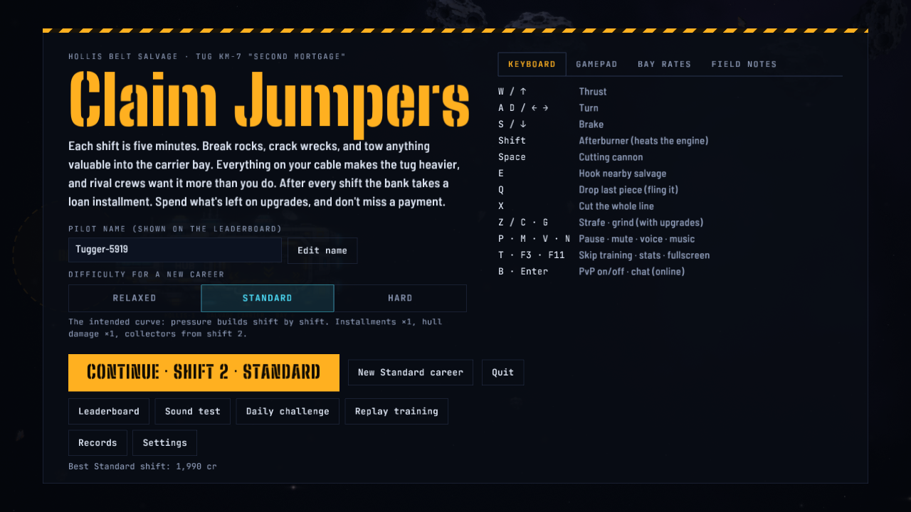
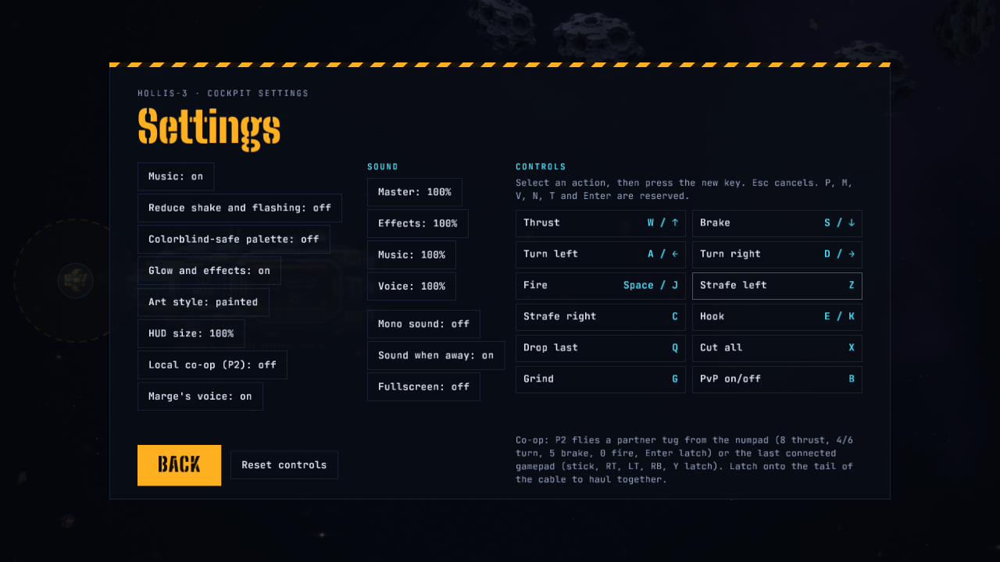
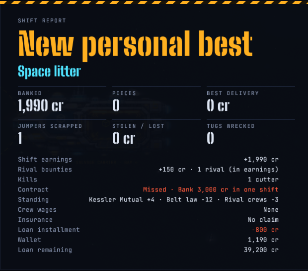
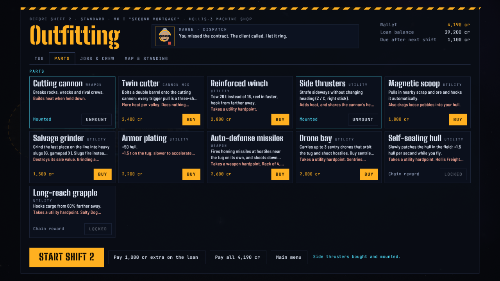
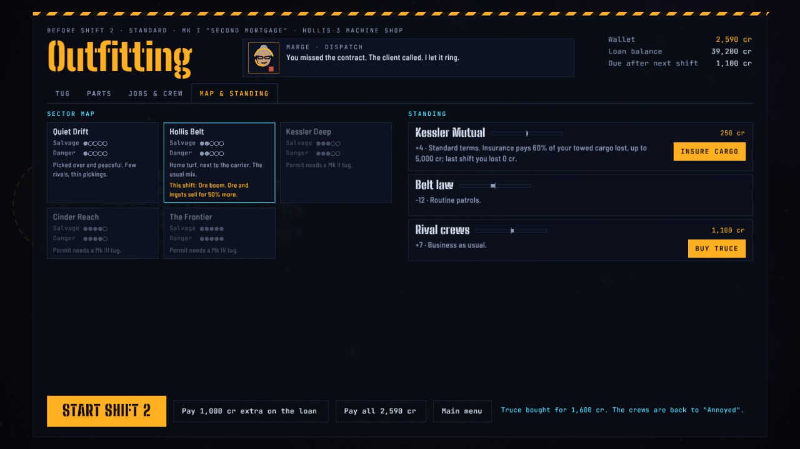

# Claim Jumpers: Gameplay Guide

You fly a salvage tug that's still on a bank loan. Each **shift** gives you
five minutes on an asteroid belt. Break rocks, cut open wrecks, hook whatever
is worth money onto your tow cable and drag it into the carrier's bay before
rival crews, debt collectors or the law take it from you. After every shift
the bank takes an installment, so earn enough to cover it, spend the rest on
the tug, and go out for the next shift.



## Contents

1. [Starting out](#starting-out)
2. [Controls](#controls)
3. [The shift](#the-shift)
4. [Reading the HUD](#reading-the-hud)
5. [Salvage and what it pays](#salvage-and-what-it-pays)
6. [Trouble in the belt](#trouble-in-the-belt)
7. [The shift report and the loan](#the-shift-report-and-the-loan)
8. [Outfitting between shifts](#outfitting-between-shifts)
9. [Belts and conditions](#belts-and-conditions)
10. [Playing with others](#playing-with-others): co-op, hosting, joining
    and PvP
11. [Strategy tips](#strategy-tips)

---

## Starting out

1. Unzip the release and run `claim-jumpers.exe`. The game is unsigned, so
   Windows may show "Windows protected your PC". Click **More info**, then
   **Run anyway**.
2. Choose **Single player**.
3. On the title screen, set your pilot name and choose a difficulty for a
   new career:

| Difficulty | What changes |
|---|---|
| **Relaxed** | Installments ×0.6, damage ×0.6, fewer rivals that arrive later, and debt collectors from shift 3. Every encounter still shows up. |
| **Standard** | The intended curve. Pressure builds shift by shift, and debt collectors start at shift 2. |
| **Hard** | Installments ×1.3, damage ×1.3, more rivals arriving sooner, debt collectors from shift 1, and higher fees. |

Your first shift runs Marge's training: five short steps covering flying,
hooking, banking, the cannon and throwing cargo. Press **T** to skip it. You
can replay it from the title screen at any time.

The title screen also has the **Daily challenge**, the same seeded field for
everyone each UTC day with a fixed loadout. It doesn't touch your career.

## Controls

| Action | Keyboard | Gamepad |
|---|---|---|
| Thrust | W or ↑ | RT or A |
| Brake / reverse | S or ↓ | LT or D-pad down |
| Turn | A D or ← → | Left stick or D-pad |
| Fire the cutting cannon | Space or J | RB |
| Hook nearest salvage (or anchor to a big rock) | E or K | Y |
| Drop the last piece | Q | B |
| Cut the whole line | X | LB |
| Strafe (needs side thrusters) | Z / C | Right stick |
| Grind the last piece (needs the grinder) | G | X |
| Afterburner | Shift | LT + RT together |
| Pause | P or Esc | Start |
| Mute, Marge's voice, music | M, V, N | Back (mute) |
| Skip training | T | |
| Fullscreen, screenshot | F11, F12 | |

You can rebind the flight keys under **Settings**. Menus work with the
keyboard, the mouse or a gamepad.



Settings also has the volume controls, reduced shake and flashing, a
colorblind-safe palette, the HUD size, the art style (painted sprites or the
original vector outlines), and local co-op for a second player.

## The shift

A shift lasts **five minutes**. The loop:

1. **Fly out from the carrier bay.** The bay is the dashed ring, and the
   off-screen arrow points to it. Parking near it repairs your hull and
   recharges your shield faster.
2. **Find value.** Shoot rocks to break them into smaller pieces, some of
   which hold ore. Cut into wrecks to spill their cargo. The first tug to
   cut a wreck **stakes a claim** on it: for 30 seconds nobody else can
   take what comes out, and the bay pays 10% more for it.
3. **Hook it.** Fly close and press **E**. Each piece goes onto the end of
   your cable, so you can tow a train of several. Every piece adds weight,
   and heavy loads swing wide and slow your turns. The winch meter shows how
   many tonnes you're towing.
4. **Bank it.** Drag your cargo into the bay ring to sell it. Cargo you
   **throw** into the bay at speed (a slingshot) pays 15% more.
5. **Repeat before the clock runs out.** Anything still on your line at the
   end of the shift isn't banked.

**Cargo is a weapon.** Swing a heavy load and press **X** to cut it loose,
and it keeps flying. A cargo smash into a rival is one of the strongest hits
in the game. **Q** drops just the last piece, which is handy for shedding a
reactor about to blow.

The **afterburner** gives you a burst of speed. Chaining bursts overheats the
engine, so watch the ENGINE meter.

## Reading the HUD


*This shot comes from the game's automated self-test, which crowds in many
systems at once: training, a wanted level, the refinery, a hauler and a
staked claim.*

| Where | What it shows |
|---|---|
| Top left | **Banked** this shift, the value **on the line** (what you're towing), your wallet, the active contract and its progress, missiles and sentries. |
| Top centre | The shift number, the belt and its condition, wanted stars and who is chasing you, alerts such as UNDER ATTACK, and the **shift clock**. |
| Top right | The **Shield**, **Hull**, **Heat** (the cannon and thrusters), **Engine** (afterburner heat) and **Winch** (tonnes towed and your limit) meters. |
| Right | The radar minimap. |
| Bottom left | Marge's radio panel. Her lines are also spoken. |
| Bottom right | A key hint for the default keys. |

## Salvage and what it pays

These are base values on Standard. Belts and conditions raise or lower them
(see [Belts and conditions](#belts-and-conditions)). Within each type the last
grade is the rare one.

| Type | Grades and base value (cr) | Notes |
|---|---|---|
| Scrap | Bent 50 · Scrap 80 · Alloy 160 | Light and easy to tow. |
| Ore | Iron 110 · Copper 170 · Cobalt 260 · Platinum 450 | Comes out of rocks you break. |
| Plate | Dented 180 · Hull 280 · Armor 420 | |
| Engine | Burnt-out 550 · Engine block 850 · Fusion drive 1,500 | Heavy (7 t). |
| Reactor core | Cracked 900 · Reactor 1,300 · Pristine 2,200 | **Volatile.** A hard knock primes it to explode. Cracked cores are fragile. |
| Ingot | Silver 500 · Gold 750 · Iridium 1,200 | From the refinery vault. |
| Flight recorder | 950 | Fragile: a hard knock costs 15% of its value. |
| Sealed cargo pod | 200 to 2,000, unknown until banked | Fragile. One in four is **contraband**: it pays double, but a patrol that spots it gives you a wanted star. |
| Keycard | — | Opens a sealed hold. |
| Mining charge | — | Volatile. Seat it in a refinery vault socket. |
| Rogue core | — | Left behind by rogue sentries. Store it, sell it, or have it reprogrammed into a sentry. |

## Trouble in the belt

- **Rival crews** (pink contacts) steal your cargo, sever your line and get
  away with it. Scrapping one pays a bounty, but each kill feeds their
  grudge and hurts your standing with the crews. Some have tempers: greedy
  crews go for the richest cargo, and skittish ones bolt when hit. Crews
  also adapt to how you fight, and they buy upgrades with the cargo they
  steal.
- **Debt collectors** come when the bank thinks your payment is at risk.
  They net your tug and tow it away: wiggle to tear the net. If your load is
  rich enough they confiscate it instead, and otherwise they impound the tug
  for a fee. Destroying one is a crime.
- **The law** reacts to wanted stars. You get them for destroying a debt
  collector (one star), destroying a lawman (two stars) or being spotted
  with contraband. Expect patrols, shakedowns, pursuit, stun bolts, arrests
  and fines, rising to Galactic SWAT at five stars. Stars fade while nobody
  is chasing you, and reaching the bay clears them.
- **Mining crews** cut the field into debris storms.
- **The Kessler refinery** is a rotating station. Tow mining charges into
  its three vault sockets to blow the vault open, which throws out ingots and
  ore. Security drones guard it. Soon after the vault blows, its **jaws**
  wake and pull in and eat anything nearby, your tug included. The jaws can
  be wrecked.
- **Crabs** latch onto cargo and chew it. Spin them off, or bank them to kill
  them.

Partway through each shift a **field event** strikes. It's one of: an
**ion storm** that drops your shields, a **derelict freighter** drifting in,
a named **boss crew** with a bounty, a **hauler** to escort home, or a
**meteor shower** of small, fast rocks.

If your tug is wrecked, the bank takes a **deductible** (500 cr on
Standard) out of what you've banked, and you respawn after a short wait.

## The shift report and the loan



When the clock runs out, the report shows what you banked, kills and
bounties, the contract result, changes in standing, crew wages, any
insurance claim, the **loan installment**, your wallet and how much of the
loan is left.

- Your first tug, the Mk I "Second Mortgage", starts with a **40,000 cr**
  loan.
- The installment starts at 800 cr and grows by 300 cr each shift (scaled
  by difficulty).
- You can go overdrawn, but only up to **a third of what you still owe**.
  Past that, the bank **repossesses** the tug and the career ends.
- Pay the loan off and you trade up to the next tug class on a bigger loan:
  Mk II "Refinance", Mk III "Balloon Payment", Mk IV "Golden Parachute" and
  Mk V "Hostile Takeover". Pay off the Mk V and you've won the career.

Your best single shift earns a rank, from *Space litter* to
*Legend of the belt* at 16,000 cr.

## Outfitting between shifts

Between shifts you're in the machine shop. The panel at the top right shows
your wallet, the loan balance and the next installment. You can also pay
extra off the loan here, which also improves the bank's view of you.

### Tug


Your tug has five hardpoints: **Weapon A and B**, a **Cannon mod**, and
**Utility A and B**. Upgrade the levelled systems (shield, engines, hull
armor, cutting cannon, missile rack, sentry firmware) for 1,500, 3,000, 5,000
and then 8,000 cr. Buy sentry drones here once you have a drone bay. The
achievements unlock paint jobs.

### Parts



| Part | Slot | Price | What it does |
|---|---|---|---|
| Cutting cannon | Weapon | stock | Breaks rocks, wrecks and rivals. Builds heat. |
| Twin cutter | Cannon mod | 2,400 | Three-shot volleys. |
| Reinforced winch | Utility | 2,800 | Tow 26 t instead of 16, reel faster, hook from farther away. |
| Side thrusters | Utility | 2,000 | Strafe with Z / C. |
| Magnetic scoop | Utility | 1,800 | Pulls in and hooks nearby scrap and ore. |
| Salvage grinder | Utility | 1,500 | Grinds the last piece on your line into slugs you fire. |
| Armor plating | Utility | 2,200 | +50 hull and +1.5 t of weight. |
| Auto-defense missiles | Weapon | 2,600 | Homing missiles that fire on their own and shoot down nets. Their blasts EMP hostile engines. |
| Drone bay | Utility | 2,000 | Carries up to 3 sentry drones. If the tug is wrecked, its sentries go rogue. |
| Self-sealing hull | Utility | contract-chain reward | Repairs 1.5 hull per second. |
| Long-reach grapple | Utility | contract-chain reward | Hooks from 60% farther away. |

Parts you own stay in the shop when you unmount them.

### Jobs and crew


- **Contracts.** Three offers come up each shift (bank a sum, scrap rivals,
  crack the vault, escort a hauler, and so on). Meet one by the end of the
  shift for its bonus. Contract chains award the unique parts.
- **Crew.** Hire one co-pilot at a time for a wage each shift. Each has a
  perk: a rigger who hooks from farther away, a claims adjuster who cuts
  fees, a fixer who calms grudges and patches the hull, or a broker who
  sells cargo for 10% more.

### Map and standing



Pick next shift's **belt** on the sector map, and keep an eye on your
standing with three factions:

- **Kessler Mutual (the bank).** Better standing changes the installment
  rate. Buy **cargo insurance** here: it covers 60% of the towed cargo you
  lose next shift, up to 5,000 cr.
- **Belt law.** A clean shift raises it.
- **Rival crews.** Scrapping them lowers it. **Buy a truce** to cool their
  grudge.

## Belts and conditions

Every shift happens on a belt, and every belt rolls a **condition** for that
shift, so the sector **shifts** under you from one shift to the next. The
better belts need a bigger tug to get a permit.

| Belt | Needs | Pay | Character |
|---|---|---|---|
| Quiet Drift | Mk I | ×0.75 | Picked over and peaceful, with few rivals. |
| Hollis Belt | Mk I | ×1.0 | Home turf next to the carrier. The usual mix. |
| Kessler Deep | Mk II | ×1.2 | Rich ore, and debt collectors everywhere. |
| Cinder Reach | Mk III | ×1.35 | An old battlefield: fat wrecks, and crews already angry. |
| The Frontier | Mk IV | ×1.6 | No law. Hostile crews and a bounty boss every shift. |

| Condition | Effect this shift |
|---|---|
| Ore boom | Ore and ingots sell for 50% more. |
| Patrol sweep | Patrols twice as often, and twice as many shakedowns. |
| Salvage glut | Three extra wrecks, but prices down 15%. |
| Rival surge | Rivals 40% more often, and boss bounties doubled. |
| Ion front | An ion storm is certain. |
| Night shift | Low visibility and short-range radar, but everything pays 30% more. |

## Playing with others

### Local co-op

Turn on **Local co-op (P2)** in Settings. Player 2 flies a partner tug from
the numpad (8 thrust, 4 / 6 turn, 5 brake, 0 fire) or from a second
gamepad. Player 2 can **latch** onto the tail of your cable (Enter on the
numpad, or Y on the gamepad) and pull, so the two of you haul one load
together.

### Online: hosting a server

Up to 20 pilots can share one shift. Everyone needs the same version of the
game.

1. On the opening screen, set up the server with the buttons under
   **Host server**:
   - **Host for up to N players** cycles 2, 4, 8, 12, 16 and 20 pilots. It
     starts at 4. The field gets bigger for more pilots.
   - **Careers** sets the difficulty of every career on the server: Relaxed,
     Standard (the default) or Hard.
   - **PvP** is **Off** by default. Turn it on to let pilots fight each
     other (see [PvP](#pvp)).
2. Press **Host server**. Your game runs the server and joins it, and the
   address other players need is shown on screen.
3. The first time you host, Windows Firewall may ask whether to allow
   Claim Jumpers. Allow it on **private networks**, or nobody else can
   connect.

**Default port: UDP 47820.** The server built into the game always uses
this port, on every network adapter. Only the separate headless server can
use another port:

```bash
cj-server --port 47820 --players 8 --mode standard
```

The headless server also takes `--pvp` to allow PvP and `--careers DIR` to
choose where careers are saved.

Where players connect from decides what the host needs to do:

| Players are… | What to do |
|---|---|
| On the same home network | Nothing more. Give them the address your game shows (it looks like `192.168.x.x`). |
| Over the internet | Forward **UDP port 47820** on your router to your PC and give out your public address. Some internet providers block this (carrier-grade NAT). |
| Over the internet, and port forwarding doesn't work | Install [Tailscale](https://tailscale.com) on every PC, put them on the same tailnet, and give out your Tailscale address (it looks like `100.x.y.z`). |

Hosting over the internet uses your upload speed: about 0.6 Mbit/s for each
pilot, and up to 1.5 Mbit/s each while everyone is in one place, such as the
bay. That's about 3 Mbit/s for 4 pilots and 8 Mbit/s for 8. If the shift
stutters for everyone at once, host fewer pilots.

The server runs inside your game, so the session ends when you leave. To
end it, open the pause card and press **Stop server** twice. It settles the
current shift first, so everyone keeps what they banked.

### Online: joining a server

1. Choose **Join remote host**.
2. Type the host's address and press **Find server**. Ctrl+V pastes. For a
   headless server on a different port, type `address:port`. The **Recent**
   list keeps the last five servers you joined.
3. The game shows how many pilots are connected, or that the server is
   full. Press **Join**.

A player who joins in a shift's last minute waits in the lobby for the next
shift. To leave, open the pause card and press **Leave server** twice.

### Online: how a shared shift works

- **Separate careers.** Each server keeps its own career for you, separate
  from your single-player career, so you start fresh on every server.
- **Between shifts** everyone gets a break to read their report, shop, and
  vote on the next belt. Only belts that every pilot's tug can fly count.
  The next shift starts when everyone is ready, or after 90 seconds.
- **Online keys.** **Tab** shows every pilot with this shift's credits,
  kills and deaths. **Enter** opens the chat: type a message and press Enter
  to send it, or Esc to cancel.
- **The shift doesn't pause.** The pause card is a menu, and the shift keeps
  running behind it.
- **Without PvP** other pilots' shots and rams stop at your tug, but never
  hurt it.

### PvP

PvP only works on servers whose host allows it, and every pilot starts each
shift **Protected**.

- **Arming.** Fly into the bay and press **B** (D-pad up). After 10 seconds
  of arming you're PvP, and everyone sees a red ring and a PVP tag on your
  tug.
- **Who can hurt whom.** A PvP pilot can hurt any tug. Anyone they hurt can
  fire back at them for 30 seconds after each attack. Ramming only does
  damage when both tugs are PvP.
- **Combat lock.** Attacking, or being hit while PvP, locks you in combat
  for 30 seconds. You can't switch PvP off until it ends, and if you leave
  the game your tug stays in the field until then.
- **The law.** On belts with law, the first hit in a fight earns the
  attacker a wanted star, and wrecking the tug earns two more. Firing back
  earns none.
- **Loot.** For 20 seconds, only its owner and PvP pilots can pick up a
  wrecked tug's cargo. PvP wrecks pay no bounty.

### Online safety

- **Join only hosts you trust.** `mp_id.txt` in your save folder is how
  servers recognise you, so keep it to yourself. Your game proves it holds
  that identity without sending it. But the first time you join a server, it
  gives the server a fingerprint of the identity, the same for every server.
  A host running a modified copy of the game could keep it and play as you,
  with your careers, on other servers you use.
- **The connection isn't encrypted,** so don't share anything private in
  the chat.

## Strategy tips

### Making money

- **Bank often.** Anything on your cable can be stolen, and anything still
  on it when the clock runs out isn't banked. Several quick runs beat one
  big haul that never gets home.
- **Go for value per tonne.** You can tow 16 t (26 t with the reinforced
  winch). An engine weighs 7 t, while a flight recorder pays 950 cr for
  half a tonne. Ore and ingots are compact earners.
- **Throw cargo into the bay.** A piece that enters the bay fast pays 15%
  more. Line up, build some speed and cut it loose toward the ring.
- **Be first into a wreck.** Cutting it open stakes your claim: what spills
  out is yours alone for 30 seconds and sells for 10% more.
- **Handle fragile cargo gently.** Sealed pods and flight recorders lose
  15% of their value in a hard knock.
- **Gamble on contraband with care.** It pays double, but a patrol that
  spots it on your line gives you a wanted star. It's safest on the lawless
  Frontier or when no patrol is nearby.
- **Pick belts by condition.** A night shift pays 30% more if you can work
  with short-range radar. An ore boom makes ore and ingots sell for 50%
  more. A salvage glut adds three wrecks but cuts prices by 15%.

### Staying alive

- **Park at the carrier to heal.** Near the bay, your hull repairs and your
  shield recharges faster. Reaching the bay also clears your wanted stars.
- **Respect reactors.** A hard knock primes them, and a cracked core blows
  easily. Drop one with **Q** if it starts to go, or throw it at a rival on
  purpose.
- **Use the rocks.** With nothing in hook range, the hook key anchors your
  line to a big rock, so you can swing round it or brake hard against it.
- **Watch your heat.** The cannon and side thrusters share a heat sink, and
  chained afterburner bursts overheat the engine.
- **Wiggle out of nets.** A debt collector's net tears as you wiggle. Auto-
  defense missiles shoot nets down before they land.
- **Don't let a wreck cost you twice.** It takes a deductible (500 cr on
  Standard) from the shift, and any sentries you carry go rogue.

### Fighting

- **Cargo is your best weapon.** A heavy piece swung hard and cut loose hits
  harder than the cannon.
- **Mix up how you kill.** Rival crews adapt to whichever method you use
  most: the cannon, cargo smashes or missiles.
- **Read the tags.** Greedy crews go for the richest cargo, so use it as
  bait. Skittish crews bolt when hit, so one shot can drive them off.
- **Use missile EMPs.** Their blasts knock out the engines of hostiles
  caught in them for 10 seconds, which leaves rivals drifting. Collectors and
  the law are only affected once you've provoked them.
- **Don't shoot debt collectors.** Destroying one earns a wanted star and
  hurts your standing with the bank.

### Managing the career

- **Keep a cushion.** The installment grows by 300 cr every shift (on
  Standard), and the bank only lets you go overdrawn by a third of what you
  owe before it repossesses the tug.
- **Pay extra when you can.** Every 1,000 cr you pay off on top of the
  installment raises your standing with the bank, which improves the
  installment rate.
- **Insure risky shifts.** Insurance covers 60% of the towed cargo you lose,
  up to 5,000 cr. It's worth it before a Frontier run or a rival surge.
- **Buy a truce when the crews get angry.** It drops their grudge and raises
  your rival standing by 10. A shift with no rival kills raises it too.
- **Take contracts that fit the belt,** like a banking target on an ore boom
  or "scrap 3 rivals" on a rival surge.
- **Upgrade the winch and engines early.** More tonnage and more thrust raise
  every later haul. Armor plating adds hull but also 1.5 t, which makes the
  tug sluggish.
- **Choose crew for your style.** A broker adds 10% to every sale, a rigger
  helps if you tow a lot, and a fixer suits a career at war with the crews.
